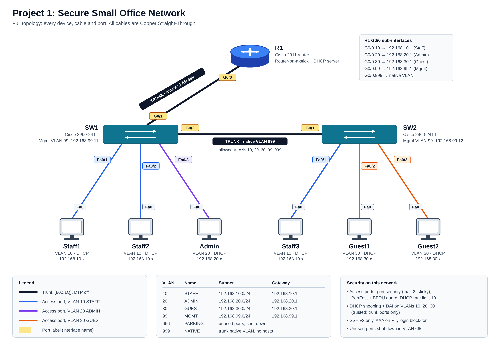

# Secure Small Office Network

## Problem
A small office had staff, admin and guest users on one flat network with no Layer 2 security, leaving it open to MAC flooding, rogue DHCP servers, ARP spoofing, rogue switches and clear-text Telnet management.

## Solution
- Segmented users into VLANs 10 (Staff), 20 (Admin), 30 (Guest) and 99 (Management)
- Inter-VLAN routing with router-on-a-stick and a DHCP server on R1
- SSH v2 only management with AAA and login brute-force protection
- Port security, DHCP snooping, Dynamic ARP Inspection and BPDU guard on access ports
- Native VLAN moved to 999, DTP disabled, unused ports shut down and parked in VLAN 666

## Topology


```
                    [R1]  Cisco 2911
                     | G0/0  (trunk, router-on-a-stick)
                     | G0/1
                   [SW1]  Cisco 2960 ──── G0/2 ── G0/1 ──── [SW2]  Cisco 2960
                  /  |  \                                   /    |    \
             Staff1 Staff2 Admin                        Staff3 Guest1 Guest2
             VLAN10 VLAN10 VLAN20                       VLAN10 VLAN30 VLAN30
```

## Addressing

| VLAN | Name | Subnet | Gateway |
|------|------|--------|---------|
| 10 | STAFF | 192.168.10.0/24 | 192.168.10.1 |
| 20 | ADMIN | 192.168.20.0/24 | 192.168.20.1 |
| 30 | GUEST | 192.168.30.0/24 | 192.168.30.1 |
| 99 | MGMT | 192.168.99.0/24 | 192.168.99.1 (SW1 .11, SW2 .12) |
| 999 | NATIVE | unused | none |
| 666 | PARKING | unused | none |

## Configurations
- [R1](configs/R1.txt)
- [SW1](configs/SW1.txt)
- [SW2](configs/SW2.txt)

Passwords are redacted.

## Verification
<!-- Add screenshots to the screenshots/ folder and link them here -->
| Check | Command | Evidence |
|-------|---------|----------|
| VLANs assigned | `show vlan brief` |  |
| Trunks with native VLAN 999 | `show interfaces trunk` |  |
| DHCP leases | `show ip dhcp binding` |  |
| Port security | `show port-security` |  |
| DHCP snooping table | `show ip dhcp snooping binding` |  |
| SSH v2 | `show ip ssh` |  |

## Security tests

| Attack | Defence | Result |
|--------|---------|--------|
| Extra devices on one port | Port security | Blocked, violation logged |
| Rogue switch | BPDU guard | Port err-disabled |
| Rogue DHCP server | DHCP snooping | Clients kept the real gateway |
| Telnet login | SSH only VTY lines | Connection refused |
| Brute-force login | `login block-for` | Logins blocked for 120 s |

## What I learned
- Layer 2 features depend on each other. Dynamic ARP Inspection checks traffic against the DHCP snooping binding table, so snooping has to be working first.
- Every switch needs to know which ports to trust. The uplinks towards R1 are marked `ip dhcp snooping trust` and `ip arp inspection trust`; without that, the real DHCP offers from the router would be dropped along with the rogue ones.
- Security is mostly about closing defaults. Moving the native VLAN to 999, turning off DTP with `switchport nonegotiate` and parking unused ports in VLAN 666 removes ways in that are open out of the box.
- Management access needs its own protection: SSH v2 only on the VTY lines, plus `login block-for 120 attempts 3 within 60` to slow down password guessing.
- Testing each feature with a matching attack (rogue DHCP server, rogue switch, Telnet) showed me what each command actually does, which reading about it did not.

## Tools
Cisco Packet Tracer 8.x, Cisco 2911 router, Cisco 2960 switches
